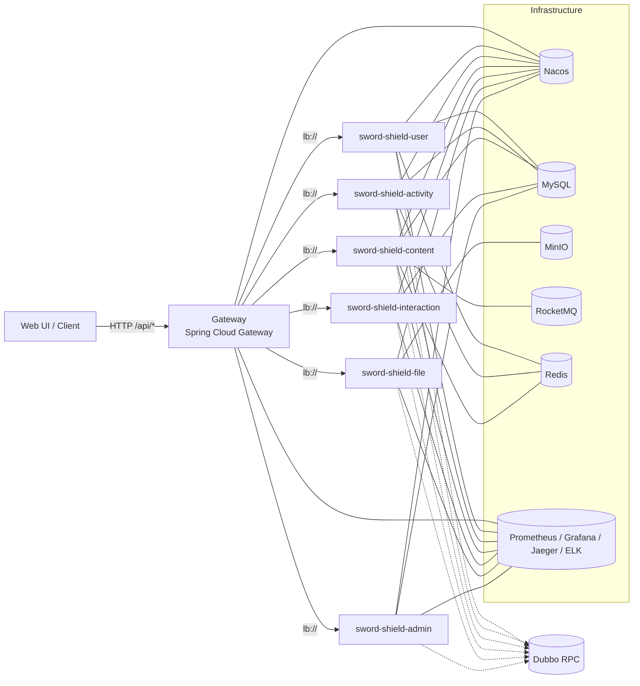

# sword-shield-web

Java 17 + Spring Boot 3.2 微服务示例工程：对外使用 Spring Cloud Gateway 统一暴露 HTTP API（`/api/**`），对内服务间调用使用 Dubbo RPC。配套 Vue 3 + Vite 前端，并内置 `docker-compose` 一键拉起基础设施与可观测链路（Prometheus/Grafana、Jaeger/OTel、ELK 等），同时提供 K8s/Helm 交付示例。

## 目录
- [架构概览](#架构概览)
- [项目亮点](#项目亮点)
- [技术栈](#技术栈)
- [模块与接口前缀](#模块与接口前缀)
- [快速开始（本地开发）](#快速开始本地开发)
- [业务示例：海报异步任务（RocketMQ）](#业务示例海报异步任务rocketmq)
- [可观测（Observability）](#可观测observability)
- [部署（Docker / K8s / Helm）](#部署docker--k8s--helm)
- [配置与约定](#配置与约定)
- [排错（Troubleshooting）](#排错troubleshooting)

## 架构概览
核心约束：**客户端只认 HTTP**，**服务间只用 Dubbo**（网关仅做 HTTP/路由/鉴权/治理，不参与 Dubbo）。



说明：
- **对外统一入口**：Gateway 通过 `lb://` 发现并路由到各服务（Nacos Discovery）。
- **对内 RPC 隔离**：Dubbo 注册到 Nacos 的独立 group（默认 `DUBBO_GROUP`），避免网关将 Dubbo 实例当作 HTTP 实例误路由。
- **共享配置**：公共配置集中在 `sword-shield-common/src/main/resources/{common.yml,observability.yml,dubbo.yml,logback-spring.xml}`，各服务通过 `spring.config.import` 引入，保证配置一致性。

## 项目亮点
- **网关统一入口（WebFlux）**：统一鉴权、路由、限流与错误模型；聚合 Swagger UI（`/swagger-ui.html`）对外提供单入口文档。
- **HTTP 与 RPC 清晰分层**：客户端只走 HTTP；服务间 Dubbo RPC；减少内部协议外泄，边界更清楚。
- **注册发现与治理闭环**：Nacos 负责注册发现（可选配置中心）；Sentinel 支持网关/服务的限流与熔断，规则可持久化到 Nacos 并热更新。
- **Dubbo 防误路由最佳实践**：Dubbo 使用独立 `application.name` + 独立 Nacos group；并提供 `traceContextFilter` 统一透传链路上下文。
- **统一安全入口**：Gateway 集成 Spring Security（OAuth2 Resource Server）校验 JWT；内部服务只关注业务与鉴权信息透传。
- **Redis 缓存与登录保护**：内容/活动读多写少接口走 Redis 缓存；登录支持失败次数锁定与按 IP/账号限速，缓解撞库/爆破。
- **异步任务与幂等**：内容服务将“海报生成 + 上传”异步化（RocketMQ），具备削峰、失败重试与消费幂等（状态原子迁移）。
- **对象存储能力**：MinIO 集成 + 预签名 URL，覆盖上传与访问的常见场景。
- **可观测一键就绪**：Actuator + Micrometer 指标；Prometheus/Grafana；OTLP 链路追踪（Jaeger）；Logstash→Elasticsearch→Kibana 日志链路；并提供 Micrometer/Javaagent 双模式避免“双重埋点”。
- **交付友好**：各服务提供 Dockerfile（多阶段缓存构建）、`docker-compose.yml` 本地依赖、`k8s/` 清单与 `helm/` Chart；探针使用标准 `liveness/readiness`，便于集群运行。
- **前端工程化**：Vue 3 + Vite + TypeScript + Element Plus + Axios + Vue Router，前后端分离开发。

## 技术栈
### 后端
- Java 17、Spring Boot 3.2（父 POM：`3.2.5`）
- Spring Cloud 2023（父 POM：`2023.0.3`）+ Spring Cloud Gateway（WebFlux）
- Dubbo 3（父 POM：`3.2.9`）+ Nacos Registry
- Spring Data JPA（Hibernate）+ MySQL
- Spring Security（OAuth2 Resource Server）+ JWT（JJWT）
- springdoc-openapi（服务端 OpenAPI + 网关聚合 Swagger UI）
- Spring Cloud Alibaba：Nacos（注册发现/可选配置中心）、Sentinel（限流/熔断/规则持久化）

### 前端
- Vue 3 + Vite + TypeScript + Element Plus + Axios + Vue Router

### 可观测与基础设施（本仓库 `docker-compose` 提供）
- Prometheus + Grafana
- OpenTelemetry（Micrometer OTLP 或 Javaagent）+ Jaeger
- Elasticsearch + Logstash + Kibana（ELK）
- RocketMQ、MinIO、Nacos、MySQL、Redis（缓存/登录保护）

## 模块与接口前缀
| 模块 | 端口 | 网关路由前缀 | 说明 |
|---|---:|---|---|
| `sword-shield-gateway` | 8080 | `/api/**` | 统一入口：鉴权/路由/治理/聚合文档 |
| `sword-shield-user` | 8101 | `/api/user/**` | 用户、登录、注册 |
| `sword-shield-activity` | 8102 | `/api/activity/**` | 活动相关 |
| `sword-shield-content` | 8103 | `/api/content/**` | 内容、海报任务等 |
| `sword-shield-interaction` | 8104 | `/api/interaction/**` | 评论、点赞等 |
| `sword-shield-file` | 8105 | `/api/file/**` | 文件/对象存储（MinIO） |
| `sword-shield-admin` | 8106 | `/api/admin/**` | 管理端接口 |
| `sword-shield-api` | - | - | DTO/RPC 接口定义（Jar，无独立端口） |
| `sword-shield-common` | - | - | 公共工具/异常/配置资源（Jar，无独立端口） |

## 快速开始（本地开发）
### 0) 依赖环境
- JDK 17、Maven 3.9+
- Node.js 18+（仅前端）
- Docker + Docker Compose（推荐：一键启动依赖与可观测）

### 1) 启动基础设施（推荐）
在仓库根目录执行：
```sh
docker-compose up -d
```

常用地址（默认配置）：
- 网关聚合 Swagger UI：`http://localhost:8080/swagger-ui.html`
- Nacos：`http://127.0.0.1:8848/nacos`
- MinIO Console：`http://localhost:9001/browser`（`admin/admin123456`）
- RocketMQ Dashboard：`http://localhost:8081`（`rocketmq/1234567`）
- Sentinel Dashboard：`http://localhost:8858`（`sentinel/sentinel`）
- Jaeger：`http://localhost:16686`
- Prometheus：`http://localhost:9090`
- Grafana：`http://localhost:3000`（`admin/admin`，已预置 Prometheus 数据源）
- Kibana：`http://127.0.0.1:5601`

数据库默认值：
- MySQL：`root/123456`，DB：`sword_shield`，端口 `13306`

### 2) 启动后端服务
建议方式：
- 在 IDE 分别运行各模块的 `main`（或使用 `spring-boot:run`）。
- 启动顺序建议：先 `docker-compose` → 再启动业务服务 → 最后启动网关（网关依赖服务注册信息进行路由）。

命令行方式（多终端分别执行）：
```sh
mvn -pl sword-shield-user -am spring-boot:run -DskipTests
mvn -pl sword-shield-activity -am spring-boot:run -DskipTests
mvn -pl sword-shield-content -am spring-boot:run -DskipTests
mvn -pl sword-shield-interaction -am spring-boot:run -DskipTests
mvn -pl sword-shield-file -am spring-boot:run -DskipTests
mvn -pl sword-shield-admin -am spring-boot:run -DskipTests
mvn -pl sword-shield-gateway -am spring-boot:run -DskipTests
```

### 3) 运行前端（`sword-shield-web-ui`）
```sh
cd sword-shield-web-ui
npm install
npm run dev
```

## 业务示例：海报异步任务（RocketMQ）
内容服务把“海报生成 + 上传”做成异步任务，避免请求线程长时间阻塞，同时具备削峰/失败重试能力。

### 调用流程
1) 创建任务：`POST /api/content/poster`（form：`title`、`subtitle`）→ 返回 `jobId`  
2) 轮询查询：`GET /api/content/poster/jobs/{jobId}` → 返回 `status` 与 `url`（成功时）

### 任务状态
- `PENDING`：任务已创建，等待投递/消费
- `PROCESSING`：已开始生成与上传
- `SUCCESS`：生成上传成功，返回 `url`
- `FAILED`：失败（返回 `errorMessage`）

### 投递重试与幂等（设计要点）
- **客户端重试（Producer）**：RocketMQ 客户端发送超时/失败会自动重试，可用 `POSTER_MQ_SEND_TIMEOUT_MS` / `POSTER_MQ_SEND_RETRY_TIMES` 调整。
- **业务重试（项目补充）**：当投递失败（如 `RemotingTimeoutException`）时，任务不会立刻失败，而是记录投递次数并按退避策略重投，直到成功或超过上限（`POSTER_MQ_DISPATCH_MAX_ATTEMPTS` 等）。
- **消费幂等**：重复消息不会导致重复执行（任务状态原子迁移 `PENDING -> PROCESSING`）。
- **可观测**：任务查询接口会返回 `dispatchAttempts`、`dispatchLastError`、`dispatchNextRetryAt` 辅助定位问题。

## 可观测（Observability）
### 指标（Prometheus / Grafana）
- 采集端点：各服务 `GET /actuator/prometheus`
- Grafana 常用看板：Spring Boot 3 Micrometer `10280`、JVM `4701`、Gateway `12900`

### 链路追踪（Jaeger / OTLP）
默认使用 W3C `traceparent` 传播（并保留 `X-Trace-Id` 作为兼容/排障头）。

两种模式（二选一）：
- **Micrometer Tracing（默认）**：通过 `OTLP_TRACING_ENDPOINT` 上报 OTLP traces；开关：`MANAGEMENT_TRACING_ENABLED=true|false`
- **OpenTelemetry Javaagent**：使用 `otel/opentelemetry-javaagent.jar` 或 `scripts/run-with-otel-agent.sh` 启动；建议将 `MANAGEMENT_TRACING_ENABLED=false` 避免双重埋点

示例（用 Javaagent 启动某个服务）：
```sh
./scripts/run-with-otel-agent.sh sword-shield-user
```
更多说明见：`otel/README.md`

### 日志（ELK）
- 通过 `LogstashTcpSocketAppender` 将日志发送到 Logstash
- 目的地址：`LOGSTASH_DESTINATION=host:port`（默认 `localhost:15000`；K8s 默认 `logstash:5000`）

## 部署（Docker / K8s / Helm）
- Docker 镜像构建：
  - 单服务示例（注意 build context 必须是仓库根目录）：`docker build -f sword-shield-user/Dockerfile -t sword-shield-user:dev .`
  - 批量构建：`./scripts/build_all.sh`
- K8s 本地 Kind 环境与说明：`k8s/README-kind.md`
- Helm Chart：`helm/sword-shield`
  - tracing 模式开关：`helm/sword-shield/values.yaml` 的 `observability.tracing.mode`（`micrometer` / `agent`）

## 配置与约定
### 健康检查与指标
- 基本：`/actuator/health`、`/actuator/info`、`/actuator/prometheus`
- K8s 探针：`/actuator/health/liveness`、`/actuator/health/readiness`
- 网关额外：`/actuator/gateway/routes`

### 统一返回结构
- 统一使用 `Response<T>`：`{ "code": number, "message": string, "data": any }`
- `code=0` 表示成功；非 0 为错误（通常与语义一致的错误码，如 `400/401/403/404/429/500/503` 等）

### 时间与序列化
- 默认时区：`APP_TIME_ZONE`（默认 `Asia/Shanghai`）
- Jackson：默认输出 ISO-8601 字符串（非时间戳），前端使用 `new Date(isoString)` 解析即可

### Sentinel 规则持久化（Nacos）
- Flow 规则存于 Nacos，Group=`SENTINEL_GROUP`，Data ID=`<spring.application.name>-sentinel-flow`
- 示例：`sword-shield-gateway-sentinel-flow`（格式 `json`）
- 典型规则 JSON：
  ```json
  [{
    "resource": "/api/user/**",
    "limitApp": "default",
    "grade": 1,
    "count": 50,
    "strategy": 0,
    "controlBehavior": 0
  }]
  ```

### 常用环境变量（速查）
- MySQL：`MYSQL_URL` / `MYSQL_USERNAME` / `MYSQL_PASSWORD`
- Nacos：`NACOS_SERVER_ADDR` / `NACOS_CONFIG_ENABLED`
- Redis：`REDIS_URL` / `REDIS_TIMEOUT`
- Sentinel：`SENTINEL_DASHBOARD` / `SENTINEL_GROUP_ID`
- JWT（网关）：`JWT_SECRET`
- Tracing：`MANAGEMENT_TRACING_ENABLED` / `TRACING_SAMPLING_PROBABILITY` / `OTLP_TRACING_ENDPOINT`
- Dubbo：`DUBBO_PORT` / `DUBBO_NACOS_GROUP` / `DUBBO_REGISTRY_ADDRESS` / `DUBBO_CONFIG_CENTER_ADDRESS` / `DUBBO_METADATA_REPORT_ADDRESS`
- RocketMQ（海报任务）：`ROCKETMQ_NAME_SERVER` / `POSTER_MQ_ENABLED` / `POSTER_MQ_TOPIC` / `POSTER_PRESIGN_EXPIRE_SECONDS`
- 登录保护（用户服务）：`LOGIN_RATE_LIMIT_IP_PER_MIN` / `LOGIN_RATE_LIMIT_USER_PER_MIN` / `LOGIN_LOCK_USER_MAX_FAILURES` / `LOGIN_LOCK_USER_LOCK_SECONDS` / `LOGIN_LOCK_IP_MAX_FAILURES` / `LOGIN_LOCK_IP_LOCK_SECONDS`

## 排错（Troubleshooting）
### Nacos 未发现实例 / 网关路由 404
- 确认 Nacos 已启动：`http://localhost:8848/nacos/v1/console/health/liveness`
- 查看实例：`curl "http://localhost:8848/nacos/v1/ns/instance/list?serviceName=sword-shield-user"`
- 如果未看到实例：先启动/重启对应服务；再确认网关配置的 `lb://<service-name>` 与 `spring.application.name` 一致

### RocketMQ Dashboard 连接异常 / 磁盘阈值
本仓库的 `docker-compose.yml` 通过让 Dashboard 共享 Broker 的网络命名空间，解决 “broker 注册为 127.0.0.1 导致 dashboard 连接到自己” 的常见问题。

<details>
<summary>RocketMQ 常见坑（本地开发）</summary>

- 如果 RocketMQ 客户端运行在其它容器/其它机器上，需要将 `ROCKETMQ_BROKER_IP1` 设为宿主机可达 IP。
- 如果看到 `CODE: 14 service not available now ... disk is full`：
  - 先清理磁盘，或
  - 临时提高阈值：`ROCKETMQ_DISK_MAX_USED_SPACE_RATIO=98`、`ROCKETMQ_DISK_SPACE_WARNING_LEVEL_RATIO=98`、`ROCKETMQ_DISK_SPACE_CLEAN_FORCIBLY_RATIO=97`
- RocketMQ store 默认使用 Docker volume（`rocketmq_store`），避免 bind-mount 到宿主机时磁盘占用过高触发阈值。
</details>

### 链路 trace 重复 / trace 不一致
- 如果使用 Javaagent：建议 `MANAGEMENT_TRACING_ENABLED=false`（脚本 `scripts/run-with-otel-agent.sh` 默认会设置）避免双重埋点
