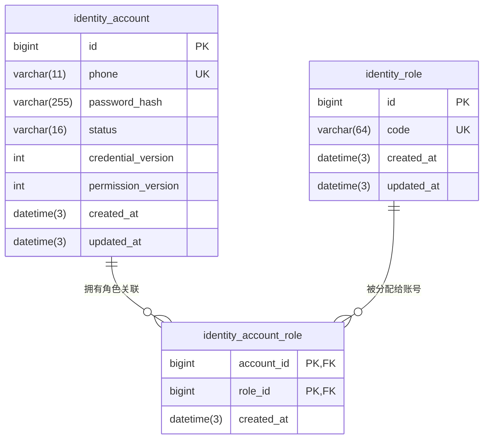

# 登录与会话阶段二 · 账号基础数据建模

版本 1.1，2026-11-22。

## 1. 范围与数据归属

本设计覆盖阶段二的账号、后台角色和初始账号数据，由 Identity 服务写入和维护。Portal 和 Admin 共用账号记录。普通用户身份由账号启用状态决定。本文件记录阶段二已实现数据模型；Admin MVP 准入调整为任一固定角色，现有迁移仅预置 SUPER_ADMIN，后续增量迁移补 EVENT_OPERATOR 与 CHECKIN_STAFF。阶段三仅实现 Portal 会话和刷新凭证；阶段四改用 Redis Session + Gateway ForwardAuth，不实施 Admin 状态镜像及 Outbox。Redis 连通和 Gateway 路由对应阶段二的服务联通任务。

设计依据为[阶段二开发计划](../../../需求/登录与会话模块/登录与会话模块技术评审_2026-11-10_19-17.md#112-阶段与完成条件)、[初始账号需求](../../../需求/登录与会话模块/账号基础数据与初始账号需求_2026-11-11_09-01.md)、[登录技术设计](../登录与会话技术设计_2026-11-21_23-14.md)和[后端数据访问与迁移规范](../../../../xihu-backend-complete-scaffold-v0.2/xihu-backend-blueprint/docs/02-工程与编码规范.md#数据访问与迁移)。

## 2. 实体关系

一个账号和一个角色各可对应零到多条关联。每条关联必须指向一个存在的账号和一个存在的角色。普通账号对应零条后台角色关联。`SUPER_ADMIN` 的角色定义只存一次，多个获授该角色的账号分别建立关联。

## 3. 字段与约束

表采用 MySQL 8、InnoDB、`utf8mb4` 和 `utf8mb4_0900_bin`，文本比较区分大小写和尾随空格。该排序规则从 MySQL 8.0.17 开始提供，字段检查使用启用的 `CHECK` 约束。见 [MySQL 字符集与排序规则](https://dev.mysql.com/doc/refman/8.0/en/charset-unicode-sets.html)和 [CHECK 约束](https://dev.mysql.com/doc/refman/8.0/en/create-table-check-constraints.html)。

### `identity_account`

| 字段 | MySQL 类型 | 约束或默认值 | 业务含义 |
| --- | --- | --- | --- |
| `id` | `BIGINT` | 主键，`AUTO_INCREMENT` | 不可变的账号标识，数据库采用有符号整数，Java 使用 `Long`，API 按现有契约输出字符串。 |
| `phone` | `VARCHAR(11)` | `NOT NULL`，全表唯一，检查整串符合 `^1[3-9][0-9]{9}$` | 中国大陆手机号，作为两端唯一登录标识。禁用账号仍保留号码的唯一占用。 |
| `password_hash` | `VARCHAR(255)` | `NOT NULL`，`CHECK (password_hash LIKE '$argon2id$_%')` | 存放包含算法、参数、盐和哈希值的 Argon2id 编码串。 |
| `status` | `VARCHAR(16)` | `NOT NULL`，创建时显式指定，`CHECK` 仅允许 `ENABLED` 和 `DISABLED` | 账号是否可用，同时作用于两端。 |
| `credential_version` | `INT` | `NOT NULL DEFAULT 1`，`CHECK >= 1` | 凭证有效性版本，后续用于识别安全状态变化前签发的凭证。 |
| `permission_version` | `INT` | `NOT NULL DEFAULT 1`，`CHECK >= 1` | 后台角色授权版本，后续用于拒绝角色关系变化前的 Admin Session。 |
| `created_at` | `DATETIME(3)` | `NOT NULL DEFAULT CURRENT_TIMESTAMP(3)` | 账号创建时间。 |
| `updated_at` | `DATETIME(3)` | `NOT NULL DEFAULT CURRENT_TIMESTAMP(3) ON UPDATE CURRENT_TIMESTAMP(3)` | 最近一次账号行改动时间。具体动作及操作者由审计事件记录。 |

写入审计时间的 JDBC 连接和生产预置 SQL 均将 MySQL 会话时区固定为 `+00:00`。手机和角色格式的 SQL 正则使用 ICU 的绝对终点 `\z`，防止尾随换行匹配。手机号长度由整串匹配约束。哈希的数据库检查只验证 Argon2id 前缀及非空内容，实际可验证性由 Identity 编码器确认。见 [Connector/J 时间处理](https://dev.mysql.com/doc/connector-j/en/connector-j-connp-props-datetime-types-processing.html)和 [MySQL 正则](https://dev.mysql.com/doc/refman/8.0/en/regexp.html)。

手机号和密码哈希限 Identity 按用途读取。对外身份摘要从 `phone` 计算 `maskedPhone`，普通日志省略完整手机号和密码哈希。

### `identity_role`

| 字段 | MySQL 类型 | 约束或默认值 | 业务含义 |
| --- | --- | --- | --- |
| `id` | `BIGINT` | 主键，`AUTO_INCREMENT` | 角色关联所用的稳定标识。 |
| `code` | `VARCHAR(64)` | `NOT NULL`，唯一，整串符合 `^[A-Z][A-Z0-9_]*$` | 角色的稳定业务编码。本期由正式迁移建立 `SUPER_ADMIN`。 |
| `created_at` | `DATETIME(3)` | `NOT NULL DEFAULT CURRENT_TIMESTAMP(3)` | 角色定义创建时间。 |
| `updated_at` | `DATETIME(3)` | `NOT NULL DEFAULT CURRENT_TIMESTAMP(3) ON UPDATE CURRENT_TIMESTAMP(3)` | 角色定义最近一次改动时间。 |

### `identity_account_role`

| 字段 | MySQL 类型 | 约束 | 业务含义 |
| --- | --- | --- | --- |
| `account_id` | `BIGINT` | `NOT NULL`，外键引用 `identity_account.id` | 获授权的账号。 |
| `role_id` | `BIGINT` | `NOT NULL`，外键引用 `identity_role.id` | 授予的后台角色。 |
| `created_at` | `DATETIME(3)` | `NOT NULL DEFAULT CURRENT_TIMESTAMP(3)` | 当前授权建立时间。撤销后重新授予记录新的建立时间。 |

联合主键 `(account_id, role_id)` 保证同一角色只能对同一账号授予一次。两个外键均采用 `ON DELETE RESTRICT` 和 `ON UPDATE RESTRICT`。撤销角色关系时删除关联记录，账号禁用时更新账号状态。见 [MySQL InnoDB 外键约束](https://dev.mysql.com/doc/refman/8.0/en/create-table-foreign-keys.html)。

## 4. 查询与索引

| 查询或约束 | 所用索引 |
| --- | --- |
| 按手机号查找账号并保证唯一 | `identity_account` 的 `UNIQUE (phone)` |
| 按 `SUPER_ADMIN` 定位角色 | `identity_role` 的 `UNIQUE (code)` |
| 列出账号的角色或判断某项授权是否存在 | `identity_account_role` 的 `PRIMARY KEY (account_id, role_id)` |
| 支撑 `role_id` 外键和反向定位已授权账号 | `identity_account_role` 的 `INDEX (role_id)` |

联合主键已支持按 `account_id` 查询，复用其左前缀。数据库内的关联使用稳定主键。迁移或预置通过唯一的手机号与角色编码定位记录，各环境生成自己的主键。见 [MySQL 多列索引](https://dev.mysql.com/doc/refman/8.0/en/multiple-column-indexes.html)。

## 5. 初始化和一致性

| 环境 | 正式 Flyway 迁移 | 账号数据 |
| --- | --- | --- |
| `dev` | 创建三张表，插入 `SUPER_ADMIN` 定义 | 单独的种子迁移插入一个启用的普通测试账号和一个启用的测试管理员，仅为后者建立角色关联。 |
| `test` | 同一套正式迁移，连接独立的测试库 | 同一套测试种子数据，供集成测试使用。 |
| `prod` | 同一套正式迁移，迁移结束时账号表和关联表为空 | 项目负责人指定首位管理员，使用受控 SQL 在一个事务内创建启用账号及其 `SUPER_ADMIN` 关联。 |

### 5.1 首位管理员的生产预置

先用 Identity 可执行包的 `--encode-password` 命令离线生成哈希。命令从终端隐藏读入密码，复用 Identity 的 Argon2id 编码器配置（盐 16 字节、输出 32 字节、内存 19 MiB、迭代 2 次、并行度 1），输出哈希后退出。真实凭证及填好的 SQL 保存在仓库之外。见 [Spring Security 密码存储](https://docs.spring.io/spring-security/reference/7.0/features/authentication/password-storage.html)。

预置脚本先将 `SUPER_ADMIN` 的主键查入变量，在同一事务内使用 `INSERT … VALUES` 插入账号和角色关联。角色查询无结果时变量为 `NULL`，关联写入由 `NOT NULL` 拒绝。批处理使用不带 `-f/--force` 的 mysql 客户端执行，SQL 错误中断脚本，连接关闭时回滚未提交事务。手机号重复同样以错误结束，原账号及授权仍保留。

### 5.2 Flyway 版本演进

正式迁移放在 `db/migration`，测试种子放在 `db/seed`，仅 `dev`、`test` 同时加载两处。两个目录统一使用北京时间 `VyyyyMMddHHmm__…` 作为版本号。合并未发布迁移之前，检查新版本号严格大于两处已合入的最大版本，处理并行开发造成的重号或倒序。已经执行的脚本通过追加新版本演进，保留 Flyway 默认的顺序控制。见 [Flyway outOfOrder](https://documentation.red-gate.com/flyway/reference/configuration/flyway-namespace/flyway-out-of-order-setting)。

### 5.3 后续账号与角色写入的并发约束

新账号的两个版本均从 `1` 开始，同事务预置的角色属于初始状态。后续涉及角色变更的写入先锁定 `identity_account` 对应行，再检查及修改 `identity_account_role`。实际发生角色变化时，在同一事务内使用 `permission_version = permission_version + 1`，并写入角色变更审计；提交后撤销 Admin Session，实时版本检查不依赖 Outbox 或状态快照。重复授予等无实际变化的请求保持原版本。实际修改密码或账号安全状态时，通过 `credential_version = credential_version + 1` 原子递增凭证版本。

禁用账号或撤销角色时，至少保留一名可用 `SUPER_ADMIN` 的全局规则由后续管理用例的应用事务负责。阶段二的数据库约束落实单行及关联完整性。

## 6. 实施验收

1. 新建三套验证库，分别运行 `dev`、`test`、`prod` 迁移。两套测试环境均有两条账号、一个角色定义和一条授权；生产验证库正式迁移后只有角色定义。
2. 在生产验证库预置一名管理员，确认账号启用且关联 `SUPER_ADMIN`。用默认遇错退出的 mysql 批处理执行真实脚本。移除测试库的 `SUPER_ADMIN` 角色后再次执行，验证客户端失败、账号创建回滚。用相同手机号再次预置，确认原记录未被覆盖。
3. 验证重复手机号、非法手机号、非法账号状态、非法哈希前缀、空白或非法角色编码、非正版本及重复角色关系会被数据库拒绝。引用不存在的账号或角色、删除仍被引用的记录也会失败。
4. 用实际密码编码器验证测试账号的正确密码能匹配，错误密码无法匹配。离线入口产生的哈希也通过同一编码器验证。检查新增时间为 UTC，而且更新账号后 `updated_at` 前进。重复运行迁移后，账号、哈希和角色关系保持一致。
