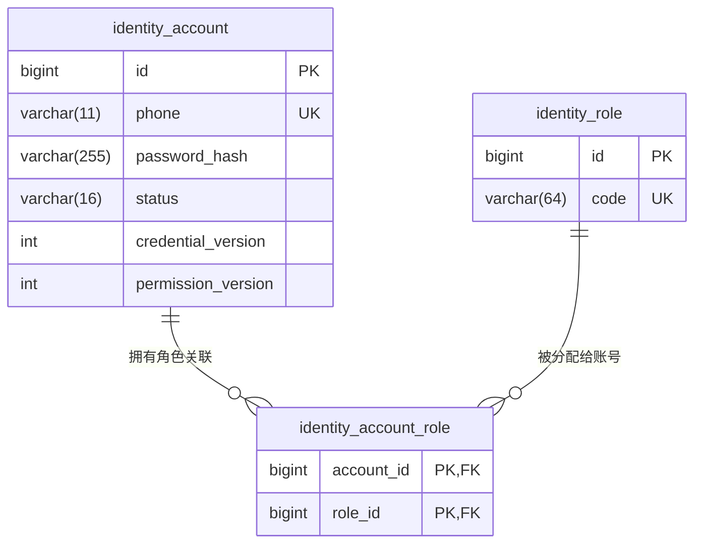

# 登录与会话阶段二 · 账号基础数据建模

## 1. 范围与数据归属

本设计覆盖阶段二的账号、后台角色和初始账号数据，由 Identity 服务写入和维护。Portal 和 Admin 共用账号记录。普通用户身份由账号启用状态决定。Admin 准入要求账号启用且已关联 `SUPER_ADMIN`。会话和刷新凭证由阶段三建模，Admin 在线状态和 Outbox 由阶段四建模。Redis 连通和 Gateway 路由对应阶段二的服务联通任务。

设计依据为[阶段二开发计划](../../需求/登录与会话模块/登录与会话模块技术评审_2026-11-10_19-17.md#112-阶段与完成条件)、[初始账号需求](../../需求/登录与会话模块/账号基础数据与初始账号需求_2026-11-11_09-01.md)、[登录技术设计](登录与会话技术设计_2026-11-21_23-14.md)和[后端数据访问与迁移规范](../../../xihu-backend-complete-scaffold-v0.2/xihu-backend-blueprint/docs/02-工程与编码规范.md#数据访问与迁移)。

## 2. 实体关系

一个账号和一个角色各可对应零到多条关联。每条关联必须指向一个存在的账号和一个存在的角色。普通账号对应零条后台角色关联。`SUPER_ADMIN` 的角色定义只存一次，多个获授该角色的账号分别建立关联。

## 3. 字段与约束

表采用 MySQL 8、InnoDB、`utf8mb4` 和 `utf8mb4_0900_bin`，文本比较区分大小写和尾随空格。该排序规则从 MySQL 8.0.17 开始提供，字段检查使用启用的 `CHECK` 约束。见 [MySQL 字符集与排序规则](https://dev.mysql.com/doc/refman/8.0/en/charset-unicode-sets.html)和 [CHECK 约束](https://dev.mysql.com/doc/refman/8.0/en/create-table-check-constraints.html)。

### `identity_account`

| 字段 | MySQL 类型 | 约束或默认值 | 业务含义 |
| --- | --- | --- | --- |
| `id` | `BIGINT` | 主键，`AUTO_INCREMENT` | 不可变的账号标识，数据库关系用整数，API 按现有契约输出字符串。 |
| `phone` | `VARCHAR(11)` | `NOT NULL`，全表唯一，检查长度为 11 且符合 `^1[3-9][0-9]{9}$` | 中国大陆手机号，作为两端唯一登录标识。禁用账号仍保留号码的唯一占用。 |
| `password_hash` | `VARCHAR(255)` | `NOT NULL` | 存放包含算法、参数、盐和哈希值的 Argon2id 编码串。 |
| `status` | `VARCHAR(16)` | `NOT NULL`，创建时显式指定，`CHECK` 仅允许 `ENABLED` 和 `DISABLED` | 账号是否可用，同时作用于两端。 |
| `credential_version` | `INT` | `NOT NULL DEFAULT 1`，`CHECK >= 1` | 凭证有效性版本，后续用于识别安全状态变化前签发的凭证。 |
| `permission_version` | `INT` | `NOT NULL DEFAULT 1`，`CHECK >= 1` | 后台角色授权版本，后续用于识别角色关系变化前的 Admin 令牌。 |

手机号和密码哈希限 Identity 按用途读取。对外身份摘要从 `phone` 计算 `maskedPhone`，普通日志省略完整手机号和密码哈希。

### `identity_role`

| 字段 | MySQL 类型 | 约束或默认值 | 业务含义 |
| --- | --- | --- | --- |
| `id` | `BIGINT` | 主键，`AUTO_INCREMENT` | 角色关联所用的稳定标识。 |
| `code` | `VARCHAR(64)` | `NOT NULL`，唯一 | 角色的稳定业务编码。本期由正式迁移建立 `SUPER_ADMIN`。 |

### `identity_account_role`

| 字段 | MySQL 类型 | 约束 | 业务含义 |
| --- | --- | --- | --- |
| `account_id` | `BIGINT` | `NOT NULL`，外键引用 `identity_account.id` | 获授权的账号。 |
| `role_id` | `BIGINT` | `NOT NULL`，外键引用 `identity_role.id` | 授予的后台角色。 |

联合主键 `(account_id, role_id)` 保证同一角色只能对同一账号授予一次。两个外键均采用 `ON DELETE RESTRICT` 和 `ON UPDATE RESTRICT`。撤销角色关系时删除关联记录，账号禁用时更新账号状态。见 [MySQL InnoDB 外键约束](https://dev.mysql.com/doc/refman/8.0/en/create-table-foreign-keys.html)。

## 4. 查询与索引

| 查询或约束 | 所用索引 |
| --- | --- |
| 按手机号查找账号并保证唯一 | `identity_account` 的 `UNIQUE (phone)` |
| 按 `SUPER_ADMIN` 定位角色 | `identity_role` 的 `UNIQUE (code)` |
| 列出账号的角色或判断某项授权是否存在 | `identity_account_role` 的 `PRIMARY KEY (account_id, role_id)` |
| 支撑 `role_id` 外键和反向定位已授权账号 | `identity_account_role` 的 `INDEX (role_id)` |

联合主键已支持按 `account_id` 查询，复用其左前缀。数据库内的关联使用稳定主键。迁移或预置通过唯一的手机号与角色编码定位记录，各环境生成自己的主键。见 [MySQL 多列索引](https://dev.mysql.com/doc/refman/8.0/en/multiple-column-indexes.html)。

## 5. 初始化和一致性

| 环境 | 正式 Flyway 迁移 | 账号数据 |
| --- | --- | --- |
| `dev` | 创建三张表，插入 `SUPER_ADMIN` 定义 | 单独的种子迁移插入一个启用的普通测试账号和一个启用的测试管理员，仅为后者建立角色关联。 |
| `test` | 同一套正式迁移，连接独立的测试库 | 同一套测试种子数据，供集成测试使用。 |
| `prod` | 同一套正式迁移，迁移结束时账号表和关联表为空 | 项目负责人指定首位管理员，使用受控 SQL 在一个事务内创建启用账号及其 `SUPER_ADMIN` 关联。 |

- 首位管理员的预置先确认 `SUPER_ADMIN` 已存在。创建账号和授权必须同时提交，任一步失败则回滚。遇到重复手机号时由唯一约束报错，保留已有账号及其角色与凭证。真实手机号、密码、哈希和填写后的生产预置 SQL 留在仓库之外。
- 每次初始化使用独立数据库。测试种子和正式迁移使用同一 Flyway 历史时，迁移版本全局唯一。已执行的变更用新版本演进。
- 新账号两个版本均从 `1` 开始，同事务预置的角色属于初始状态。后续实际变更密码或账号状态，在同一事务中递增 `credential_version`。实际变更账号角色关系，在同一事务中递增 `permission_version`。阶段四的在线状态事件与对应数据变更同事务记录。

## 6. 实施验收

1. 新建三套验证库，分别运行 `dev`、`test`、`prod` 迁移。两套测试环境均有两条账号、一个角色定义和一条授权；生产验证库正式迁移后只有角色定义。
2. 在生产验证库预置一名管理员，确认账号启用且关联 `SUPER_ADMIN`。模拟授权写入失败，验证账号创建也被回滚。用相同手机号再次预置，确认原记录未被覆盖。
3. 验证重复手机号、非法手机号、非法账号状态、非正版本及重复角色关系会被数据库拒绝。引用不存在的账号或角色、删除仍被引用的记录也会失败。
4. 用实际密码编码器验证测试账号的正确密码能匹配，错误密码无法匹配。重复运行迁移后，账号、哈希和角色关系保持一致。
