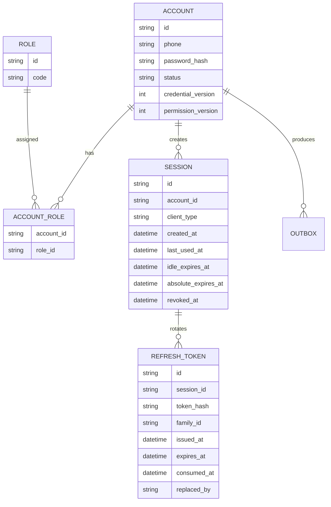

# 登录与会话模块技术评审文档

| 项目 | 内容 |
| --- | --- |
| 项目 | 西湖论剑 · 大会门户 |
| 模块 | Identity — 登录与会话 |
| 版本 | v1.0 |
| 评审阶段 | 需求明确后、代码实现前 |
| 评审状态 | 方案已形成，待技术评审确认 |
| 代码基线 | `sry8848/sword_shield_web` 的 `main` 分支，本地落盘核对点为 `a495ae3` |

> 第 3、4 节区分原评审稿描述的历史状态与落盘时发现的基线差异。公共错误响应相关实施项需在评审时确认剩余范围。

## 1. 需求分析

### 1.1 需求来源

本次技术评审以[《登录与会话模块业务设计文档》](../../设计/登录设计_2026-11-09_15-26.md)为业务依据。本期交付统一账号体系下的登录与会话能力。

系统有两个应用。Portal 面向普通参会用户，Admin 面向运营工作人员。两边共用账号，登录入口、会话、Cookie、Access Token 和前端登录状态相互独立。同一账号可同时登录两边。

### 1.2 预期行为

**Portal**

1. 用户输入手机号和密码，服务端校验账号、密码和账号状态。
2. 认证成功后建立 Portal 会话，返回短期 Access Token，通过 HttpOnly Cookie 设置 Refresh Token。
3. 用户刷新浏览器后可以恢复登录状态。
4. 退出使当前 Refresh Token 失效。Portal 使用短期无状态 JWT，退出或账号禁用后，已签发的 Access Token 最多还可能有效 10 分钟。

**Admin**

1. 用户输入手机号和密码，服务端校验账号、密码、账号状态及有效后台角色。
2. 认证成功后建立 Admin 会话，返回独立的 Access Token 和 Refresh Token。
3. 每次访问后台受保护接口时验证 JWT，并检查 Redis 中的在线安全状态。
4. 账号禁用、后台角色撤销、当前会话退出后，旧凭证的撤权传播目标为 5 秒。

### 1.3 本期范围

| 本期实现 | 后续实现 |
| --- | --- |
| Portal、Admin 登录和会话恢复 | 注册、短信验证 |
| 账号与密码认证、后台身份准入 | 后台角色管理、细粒度 RBAC |
| Access Token 签发与验证、Refresh Token 轮换 | 忘记密码、MFA |
| 会话持久化与撤销、当前用户信息查询、首位超级管理员预置 | |

本期账号和会话模型为后续注册和角色管理提供接入点。

## 2. 最小必要模型

### 2.1 核心概念

| 概念 | 必要信息与规则 |
| --- | --- |
| Account | `id`、全局唯一的中国大陆 11 位手机号 `phone`、`password_hash`、`status`（`ENABLED` / `DISABLED`）、`credential_version`、`permission_version`。凭证版本用于密码重置或账号安全状态变化，权限版本用于后台授权关系变化。字段名可调整，但需要等价的版本能力。 |
| Role | 本期定义 `SUPER_ADMIN` 和账号角色关联，用于判断账号是否具有有效后台角色。 |
| Session | `id`、`account_id`、`client_type`（`PORTAL` / `ADMIN`）、`created_at`、`last_used_at`、`idle_expires_at`、`absolute_expires_at`、`revoked_at`。一个账号可以在不同应用、设备建立多个会话，退出只撤销当前会话。 |
| Refresh Token | 保存 Token 哈希、所属会话、签发时间、过期时间、使用状态及替换关系。每次成功刷新签发新 Token，旧 Token 不能再次使用。 |
| Online Security State | Redis 保存 Admin 请求所需的账号启用状态、会话有效性和后台权限版本。Portal 请求只验 JWT。 |

### 2.2 模型关系



Outbox 保存可靠同步在线安全状态所需的事件记录。

### 2.3 核心流程

- **登录**。按手机号查询账号，验证密码和账号状态。Admin 额外检查后台角色。随后创建会话，签发 Access Token 和 Refresh Token，在响应体返回前者并通过 `Set-Cookie` 设置后者。
- **刷新**。读取 Refresh Cookie，计算哈希，查询并锁定 Token 记录。验证 Token、会话和账号，Admin 再验证当前后台角色。消费旧 Token，签发新 Token，返回新 Access Token 并更新 Cookie。
- **退出**。从 Refresh Cookie 识别当前会话，撤销会话和 Refresh Token。Admin 同步撤销 Redis 会话状态，随后清除对应 Cookie。

### 2.4 设计取舍

| 设计 | 决定与依据 |
| --- | --- |
| Refresh Token 轮换及历史 | 本期实现。轮换限制旧凭证复用，保留历史用于识别重放。 |
| 会话持久化 | 本期实现。支持多设备会话、退出与撤销。 |
| Redis 在线状态 | 本期实现。受保护后台请求能快速拒绝旧权限。 |
| Outbox | 本期实现。MySQL 提交撤权后，进程可能在更新 Redis 前崩溃。与状态变更同事务记录事件，服务恢复后可继续投递。范围限定为身份安全状态同步。 |
| JWKS | 采用。多个服务可独立验签，密钥轮换可通过公钥发布完成。 |
| Argon2id | 本期实现。提高密码哈希泄露后的批量猜测成本。 |
| 跨标签页刷新协调 | 本期实现。多个标签页同时消费同一 Refresh Token 可能触发重放检测。 |
| 本地权限缓存 | 暂缓。缓存延迟会扩大后台撤权窗口。 |
| Kafka / RabbitMQ | 暂缓。Outbox 直接投递 Redis。 |
| 完整 RBAC、MFA、设备管理页面、独立认证微服务 | 留待后续评估或实施。 |

## 3. 当前代码与规范

### 3.1 后端代码

后端根目录为 [backend](../../../xihu-backend-complete-scaffold-v0.2/xihu-backend-blueprint/backend/)。

| 模块 | 当前链路与能力 |
| --- | --- |
| Gateway | `GatewayApplication.java` 启动 Spring Boot，使用 WebFlux Gateway 和 Actuator。配置包括 8080 端口、应用名和健康检查。正式业务路由、认证过滤链和身份上下文注入尚未接入。 |
| Identity Service | `IdentityApplication.java` 启动 Spring Boot，运行在 8081 端口，已有 MVC、Actuator。原稿将其描述为仅有启动入口，本地 `main` 已增加 MVC 异常处理及请求追踪。账号、登录、角色查询、会话和 JWT 业务链路待建。 |
| Activity Service | `ActivityApplication.java` 启动 Spring Boot，运行在 8082 端口，使用 MVC 和 Actuator。JWT 验证与业务授权待建。 |

现有后端没有可复用的登录业务链路。目标链路由 Gateway 转发至 Identity 或 Activity，服务内由 Spring Security 验证 JWT，Admin 请求再校验 Redis 在线状态，之后进入应用用例和业务层。

### 3.2 后端规范

| 规范 | 已有约束及本次落实 |
| --- | --- |
| 01 总体架构与数据所有权 | Identity 拥有账号、会话、角色、权限及账号直接角色分配。Gateway 负责路由与治理。业务服务拥有自身业务数据，并使用验证后的身份授权。本期在 Identity 实现认证。 |
| 02 工程与编码规范 | 保留 Controller、Application、Domain、Infrastructure 分层，以 OpenAPI 为契约。成功用 `ApiEnvelope<T>`，失败用 RFC 9457 Problem Details。业务异常与 HTTP 异常分离，数据库使用版本化迁移，配置和密钥外置，禁止明文保存或记录密码及会话凭证。 |
| 03 权限、数据范围、组织、租户与审批 | Identity 负责认证、会话和 RBAC 配置，业务服务负责功能权限及资源范围校验。绕过网关直连管理接口同样需要保护，权限撤销要在明确时限内生效。Admin 每请求检查 Redis 在线状态。 |

规范原文见[后端工程规范目录](../../../xihu-backend-complete-scaffold-v0.2/xihu-backend-blueprint/docs/)。

### 3.3 前端代码与规范

[Shared HTTP Client](../../../xihu-jian-frontend/packages/shared/src/http/client.ts) 已通过 Axios 拦截器从外部读取 Access Token 并附加 Bearer。收到 `ACCESS_TOKEN_EXPIRED` 对应的 401 后，同一 Axios 实例内的请求共用一次刷新，成功后原请求最多重试一次。实现区分新旧 Token，避免旧请求错误清除新会话，刷新失败时调用 `onUnauthorized`。

待接入 Cookie 凭证传递、跨标签页刷新协调以及 Portal 和 Admin 独立认证客户端。`request()` 读取 `message` 和 `details`，需改为解析 Problem Details 的 `detail` 和 `errors`。

现有路由与状态管理规范要求两端维护独立路由，使用 Pinia 管理会话身份，由浏览器管理 Refresh Cookie，进入受保护页面前先恢复会话，退出或切换账号时清理身份和私有查询缓存。后端服务承担实际的认证与授权。见[前端工程规范目录](../../../xihu-jian-frontend/docs/)。

### 3.4 OpenAPI 现状

原评审稿记录的契约使用 `/auth/register`、`/auth/login`、`/auth/refresh`、`/auth/logout`、`/auth/me`。其中注册属于后续范围。登录字段 `account` 允许 3～64 位，Access Token 示例有效期为 7200 秒。契约使用单个 `refreshToken` Cookie，Path 为 `/api/v1/auth`。`UserProfile` 同时包含 `account` 和 `phone`，前后台入口、轮换与重放规则及 Admin 在线状态错误需要细化。契约见 [openapi.yaml](../../../xihu-jian-frontend/openapi/openapi.yaml)。

## 4. 差异、成本与收益

### 4.1 后端认证基础设施

| 差异 | 改动 | 成本与收益 |
| --- | --- | --- |
| Identity 缺少认证过滤链和 JWT | 接入 Spring Security，增加 JWT 签发与 Resource Server 验证。 | 中，复用成熟过滤链，支持多服务独立验签。 |
| 缺少数据库接入和迁移 | 接入 MySQL 8、MyBatis-Plus 和 Flyway。 | 中，持久化账号、角色和会话。迁移脚本按版本管理。 |
| 缺少 Redis | 接入 Admin 在线状态。 | 中，缩短后台撤权传播时间。 |
| 缺少密码哈希 | 接入 Argon2id。 | 低，使用密码专用算法保存凭证。 |

### 4.2 拆分认证入口

将共享的 `/auth/login`、`/auth/refresh`、`/auth/logout`、`/auth/me` 拆分为 `/auth/portal/*` 和 `/auth/admin/*`。接口、Cookie 和安全策略可独立配置。请求路径即可区分应用，底层复用应用用例。改动成本低。

### 4.3 JWT 与在线状态

纯 JWT 的校验只需要验签与 Claims 检查，撤销效果受已签发 Token 的剩余有效期约束。Portal 接受最多 10 分钟的剩余有效窗口。Admin 每个受保护请求通过一次 Redis 批量读取确认状态，代价是增加一次网络往返，所有资源服务读取同一份在线状态。

### 4.4 五秒撤权传播目标

- `T0` 为身份变更事务提交时刻。
- `T1` 为 Redis 在线状态更新完成时刻。
- `T2` 为业务服务开始拒绝旧权限的时刻。
- 正常运行条件下，目标为 `T2 - T0 ≤ 5 秒`。Redis 更新后，业务服务的下一次请求读取即可识别变化。

身份状态或角色变更与 Outbox 事件写入同一 MySQL 事务。提交后立即尝试更新 Redis，成功后完成事件，失败由 Outbox 重试。Redis 故障、事件积压或状态恢复导致无法确认在线安全状态时，Admin 访问失败关闭。

未来角色撤销和账号禁用接口须在 Redis 确认更新后向操作者报告完成。同步超时应返回明确的处理中或失败结果。本期建立必要的 Outbox 和状态同步机制。

### 4.5 本地权限缓存

Admin 每次受保护请求读取 Redis。若服务节点缓存旧版本 30 秒，即使 Redis 已完成更新，该节点仍可能放行旧权限，超过 5 秒传播目标。

### 4.6 消息中间件

本期使用 MySQL Outbox 和轻量投递任务直连 Redis。引入 Kafka 或 RabbitMQ 会增加部署、积压治理、消费者幂等和监控成本。其他业务域出现跨服务事件需求时再统一评估。

### 4.7 公共错误响应

原评审稿记录 `common/ApiFailure.java` 使用 `code`、`message`、`details`、`traceId`、`timestamp`，并记录 `ApiEnvelope.ok()` 在缺少 MDC `traceId` 时生成随机 UUID。落盘核对时，`main` 已移除 `ApiFailure`，Identity 已具备 MVC Problem Details 与请求追踪。该部分实施范围需以现有实现为基础复核。见[Identity MVC 异常处理技术评审](../Identity%20MVC%20异常处理/Identity%20MVC%20异常处理技术评审_2026-11-09_19-05.md)。

成功响应沿用 `ApiEnvelope<T>`。错误响应遵循 RFC 9457，字段包括 `type`、`title`、`status`、`detail`、`code`、`traceId`、`timestamp` 和可选的 `errors`。MVC 普通异常使用现有处理入口，Spring Security 的 `AuthenticationEntryPoint`、`AccessDeniedHandler` 及 Gateway 的 WebFlux 异常处理需与该契约一致。响应的 `traceId` 来自实际请求追踪上下文。

## 5. 最终技术方案

### 5.1 服务职责

| 服务 | 职责 |
| --- | --- |
| Identity Service | 作为认证权威，负责账号查询、密码验证、后台角色准入、会话创建、Access Token 签发、Refresh Token 轮换、当前用户查询、当前会话退出、身份安全状态更新、JWKS 发布及 Outbox 投递。 |
| Activity Service | 验证 JWT 和受众，校验 Admin Redis 会话状态，从已验证凭证获得身份，承担后续业务权限和资源范围校验。客户端提交的用户 ID 不作为当前身份依据。 |
| Gateway | 转发认证和业务请求，处理 CORS、追踪上下文传播及入口治理。资源服务自身仍负责认证与授权。 |

### 5.2 Token 设计

**Access Token**

采用 JWT + RS256，有效期 600 秒。Identity 用私钥签发，通过 JWKS 发布公钥供资源服务独立验签。前端在内存保存 Token，通过 Bearer 传输。Portal 和 Admin 使用独立的 audience，防止跨应用使用。

| Claim | 用途 |
| --- | --- |
| `sub` | 用户 ID |
| `sid` | 会话 ID |
| `iss` | 签发者 |
| `aud` | 对应应用 API |
| `iat` | 签发时间 |
| `exp` | 过期时间 |
| `jti` | Token 唯一标识 |
| `client_type` | `PORTAL` / `ADMIN` |
| `credential_version` | 账号凭证版本 |
| `permission_version` | 后台权限版本 |
| `roles` | 当前角色集合 |

本期 Claims 满足后台身份准入。完整权限码映射留给后续 RBAC 模块。

**Refresh Token**

使用 256 bit 安全随机数生成不透明 Token。空闲期限 7 天，绝对期限 30 天，每次成功刷新轮换。MySQL 保存 SHA-256 哈希，客户端通过 HttpOnly Cookie 持有原始凭证。高熵随机 Token 直接使用 SHA-256。

### 5.3 密码哈希与登录限流

通过 Spring Security 的 `Argon2PasswordEncoder` 和 Bouncy Castle 实现 Argon2id。初始参考参数为 19 MiB 内存、2 次迭代、并行度 1、16 字节 Salt、32 字节哈希。上线前测试性能。

未知手机号也执行一次虚拟密码哈希验证，减少账号枚举的时间差异。Redis 按手机号和来源 IP 等维度分别限制登录频率，阈值通过测试确定。

### 5.4 手机号

支持中国大陆 11 位手机号，初步格式为 `^1[3-9]\d{9}$`，数据库使用字符串。手机号归属验证由后续注册业务负责。

### 5.5 API 与 Cookie

| 操作 | Portal | Admin |
| --- | --- | --- |
| 登录 | `POST /api/v1/auth/portal/login` | `POST /api/v1/auth/admin/login` |
| 刷新 | `POST /api/v1/auth/portal/refresh` | `POST /api/v1/auth/admin/refresh` |
| 退出 | `POST /api/v1/auth/portal/logout` | `POST /api/v1/auth/admin/logout` |
| 当前身份 | `GET /api/v1/auth/portal/me` | `GET /api/v1/auth/admin/me` |

登录请求示例。

```json
{
  "phone": "13800000000",
  "password": "Password123"
}
```

| 应用 | Refresh Cookie 名称 | Path |
| --- | --- | --- |
| Portal | `portal_refresh_token` | `/api/v1/auth/portal` |
| Admin | `admin_refresh_token` | `/api/v1/auth/admin` |

Cookie 使用 HttpOnly，生产环境启用 Secure，默认 SameSite=Lax，不设置 Domain。使用 Cookie 认证的接口校验 Origin，跨站部署额外使用 CSRF 防护。

### 5.6 Redis 在线状态

| 键 | 字段 |
| --- | --- |
| `identity:account:{userId}` | `status`、`credentialVersion`、`permissionVersion` |
| `identity:session:{sessionId}` | `status`、`accountId`、`clientType` |

Admin 受保护请求本地验签并校验 `iss`、`aud`、`exp`，再向 Redis 权威主节点执行一次 `MGET`，检查账号状态、会话状态及凭证和权限版本。状态缺失、无法确认或 Redis 不可用时拒绝放行。Portal 受保护请求只执行 JWT 校验。

### 5.7 数据库模型

| 表 | 用途 |
| --- | --- |
| `identity_account` | 账号 |
| `identity_role` | 角色定义 |
| `identity_account_role` | 账号角色关系 |
| `identity_session` | 会话 |
| `identity_refresh_token` | Refresh Token 轮换记录 |
| `identity_outbox` | 身份安全状态事件 |

数据库采用 MySQL 8，Flyway 管理迁移。细粒度 RBAC 需要时再评估 `identity_permission` 和 `identity_role_permission`。

### 5.8 Spring Security

Identity 和 Activity 使用 Spring Security JWT Resource Server。按路径和 audience 区分公共请求、两端认证入口和受保护业务请求。Admin 受保护请求增加 Redis 状态校验。认证失败和授权拒绝使用 Problem Details。Gateway 保留 WebFlux 配置。

## 6. 代码实施方案

### 6.1 Maven 与 Gateway

| 模块或文件 | 计划 |
| --- | --- |
| `backend/pom.xml` | 集中管理必要依赖版本，保持现有 Spring Boot、Spring Cloud 版本，验证 Spring Boot 4.1.2 与选定依赖的兼容性。 |
| `backend/identity-service/pom.xml` | 增加 Spring Security、OAuth2 Resource Server / JOSE、MyBatis-Plus、MySQL Connector/J、Flyway、Spring Data Redis、Bouncy Castle 和 Validation。 |
| `backend/activity-service/pom.xml` | 增加 Spring Security、OAuth2 Resource Server 和 Spring Data Redis。 |
| Gateway | 保留现有 WebFlux Gateway，配置正式路由。 |

### 6.2 Identity Service

在 `identity-service/src/main/java/com/swordshield/next/identity/` 下按实际职责创建目录。

| 位置 | 职责或计划入口 |
| --- | --- |
| `interfaces/http/` | `PortalAuthController.java`、`AdminAuthController.java` 和 `dto/`。Controller 通过用例处理认证。 |
| `application/auth/` | `LoginUseCase.java`、`RefreshSessionUseCase.java`、`LogoutUseCase.java`。编排认证与事务。 |
| `application/query/` | `GetCurrentUserUseCase.java`、`GetAdminProfileUseCase.java`。 |
| `domain/account/`、`domain/session/`、`domain/authorization/` | 维护账号、会话和后台准入规则。 |
| `infrastructure/persistence/` | 持久化 `entity/` 和 `mapper/`。 |
| `infrastructure/security/`、`infrastructure/redis/`、`infrastructure/outbox/`、`config/` | JWT、密码哈希、Redis、安全事件投递和配置。 |

### 6.3 Activity Service

计划在 `activity-service/src/main/java/com/swordshield/next/activity/` 下保留 `ActivityApplication.java`，新增 `config/SecurityConfiguration.java`、`infrastructure/security/JwtAuthenticationConfiguration.java` 和 `infrastructure/security/AdminSessionVerifier.java`，建立可供后续业务接口使用的认证保护机制。

### 6.4 Common

沿用 `ApiEnvelope`，确保 `traceId` 来自实际追踪上下文。错误响应统一遵守 Problem Details。Common 只承载轻量公共能力，账号、业务异常和 Token 实现留在服务内。现有错误处理和追踪的复用范围见 4.7。

### 6.5 前端 Shared

在 `packages/shared/src/http/client.ts` 及其认证接入层保留 Bearer 注入、401 错误识别、单实例并发刷新、原请求重试和旧会话保护。接入 Cookie 凭证传递、前后台独立认证 Client、跨标签页刷新协调、`ACCESS_TOKEN_STALE` 处理、Problem Details 解析和退出清理。跨标签页采用 BroadcastChannel 协调，Access Token 保存在内存。

### 6.6 Portal

在 `apps/portal` 实现登录页面、Auth API、Auth Store、初始化会话恢复、当前用户查询，以及登录和退出状态管理。使用 Portal 专属接口和 Cookie。

### 6.7 Admin

在 `apps/admin` 实现独立登录页面、Auth API、Auth Store、初始化会话恢复和当前后台身份查询。无后台资格时拒绝进入，登录失效时清理状态并跳转。使用 Admin 专属接口和 Cookie。

### 6.8 OpenAPI

计划修改 `xihu-jian-frontend/openapi/openapi.yaml`。

1. 拆分 Portal 和 Admin 的登录、刷新、退出及当前身份接口。
2. 将登录字段 `account` 改为 `phone`，限定中国大陆 11 位手机号。
3. 将 Access Token 有效期改为 600 秒。
4. 定义两个 Refresh Cookie 及其 Path。
5. 明确轮换和重放检测规则。
6. 定义 Admin 权限版本失效等错误。
7. 定义 JWKS 发布接口。
8. 统一 `UserProfile` 的手机号语义，注册保留为后续业务范围。

错误响应继续使用 RFC 9457 Problem Details。下表为拟增加的错误，评审后同步到 OpenAPI。

| 错误码 | HTTP | 含义 |
| --- | --- | --- |
| `ACCESS_TOKEN_STALE` | 401 | 后台 Token 的权限或凭证版本已过期，需要刷新。 |
| `ADMIN_ACCESS_REVOKED` | 403 | 账号已失去后台访问资格。 |
| `AUTH_STATE_UNAVAILABLE` | 503 | 无法确认后台在线认证状态。 |
| `TOO_MANY_REQUESTS` | 429 | 登录尝试受到频率限制。 |

## 7. 实施顺序

| 阶段 | 任务 | 主要交付 |
| --- | --- | --- |
| 1 | OpenAPI 认证契约 | 接口、DTO、Cookie、错误码。 |
| 2 | 后端认证基础设施 | Maven 依赖、Security、数据库、Flyway、Redis。 |
| 3 | 账号与密码认证 | Account、Argon2id、登录用例。 |
| 4 | Session 与 Token | JWT、Refresh Token、轮换、退出。 |
| 5 | Admin 在线校验 | Redis 状态、权限版本、Outbox。 |
| 6 | 前端接入 | Portal 和 Admin 独立登录与会话恢复。 |
| 7 | 集成与安全测试 | 端到端验证及故障场景。 |

各阶段分别验收。阶段 2 验证 MySQL 8 和 Redis 连通、Flyway 迁移、Spring Security 启动、Gateway 路由及 Activity 直连认证保护。

## 8. 测试与验收

### 8.1 后端单元测试

覆盖密码正确与错误、账号不存在、账号禁用、Admin 无后台角色、Portal 正常登录、Refresh Token 过期及重放、会话撤销、权限版本不一致。

### 8.2 MySQL 集成测试

使用真实 MySQL 8，验证手机号唯一约束、会话创建与撤销、Refresh Token 轮换事务、两个请求并发消费同一个 Token、事务回滚，以及 Outbox 重试与幂等。

### 8.3 Redis 集成测试

验证 Admin 登录后创建在线状态、退出后会话失效、账号禁用或角色版本变化后旧 Token 被拒绝。覆盖 Redis 不可用、状态缺失及 Redis 恢复后重新同步。

### 8.4 前端测试

验证两端同时登录、同一应用多标签页刷新、Access Token 自动刷新、Refresh Token 失效、退出、旧请求响应与新会话隔离、私有查询缓存清理和登录后恢复原目标页面。

### 8.5 最终验收

1. 同一账号可以同时登录 Portal 和 Admin。
2. 两个 Cookie 相互独立。
3. 普通账号无法登录后台。
4. 同一账号可在多设备登录。
5. Access Token 10 分钟过期。
6. Refresh Token 空闲期限 7 天、绝对期限 30 天。
7. 每次成功刷新都轮换 Refresh Token。
8. 能识别旧 Refresh Token 重放。
9. 正常运行条件下，Admin 撤权传播目标不超过 5 秒。
10. Portal 受保护请求无需读取 Redis。
11. 直连 Activity 的受保护接口同样需要授权。
12. Redis 故障时 Admin 受保护接口失败关闭。

## 9. 风险与边界

| 风险 | 处理方式 |
| --- | --- |
| 并发刷新触发重放误判 | 前端跨标签页协调，后端原子消费。 |
| MySQL 与 Redis 状态不一致 | Outbox、幂等更新和重试。 |
| Redis 故障 | Admin 访问失败关闭。 |
| JWT 私钥泄露 | 私钥外置，支持密钥轮换。 |
| Cookie CSRF | SameSite、Origin 校验及必要的 CSRF Token。 |
| Argon2id 开销过高 | 登录限流及性能测试。 |
| 撤权后继续使用旧后台 Token | Admin 每请求检查权限版本和会话状态。 |
| Portal 退出后旧 JWT 仍有效 | 接受最多 10 分钟的剩余有效窗口。 |
| 旧会话请求晚到 | 前端按会话隔离状态与缓存。 |

登录、认证失败、退出和身份安全变更保留必要的持久化安全审计记录。设备管理、MFA、登录历史查询和复杂风控留待后续。

## 10. 待评审结论

### 10.1 架构与关键取舍

方案采用统一 Identity Service、JWT RS256、Refresh Token 轮换、MySQL 8 和 Admin Redis 在线状态校验。沿用 Gateway 与前端 HTTP 基础设施。

1. Portal 和 Admin 共用账号，认证接口、Cookie、会话和 audience 独立。
2. Portal 使用短期 JWT，接受最多 10 分钟的旧 Access Token 窗口。
3. Admin 使用 JWT + Redis，每次受保护请求检查在线状态。
4. 身份状态通过 Outbox 可靠同步，正常运行下撤权传播目标为 5 秒。
5. 密码使用 Argon2id，账号、会话和 Refresh Token 哈希使用 MySQL 持久化。

### 10.2 本次范围之外

注册、短信验证、角色管理页面、完整权限配置、组织数据范围、MFA、密码找回、独立认证微服务、消息中间件和本地权限缓存。

### 10.3 开发执行原则

1. 技术评审文档记录方案推导与取舍。
2. 业务设计文档冻结业务行为。
3. OpenAPI 冻结前后端接口契约。
4. 后端工程规范约束代码实现。
5. 发现文档冲突或实现障碍时，先报告问题、出处、影响及建议方案。
6. 按确认后的本期范围实施。

技术评审确认后，正式整理技术设计文档和 OpenAPI 契约，再进入登录业务实现。
