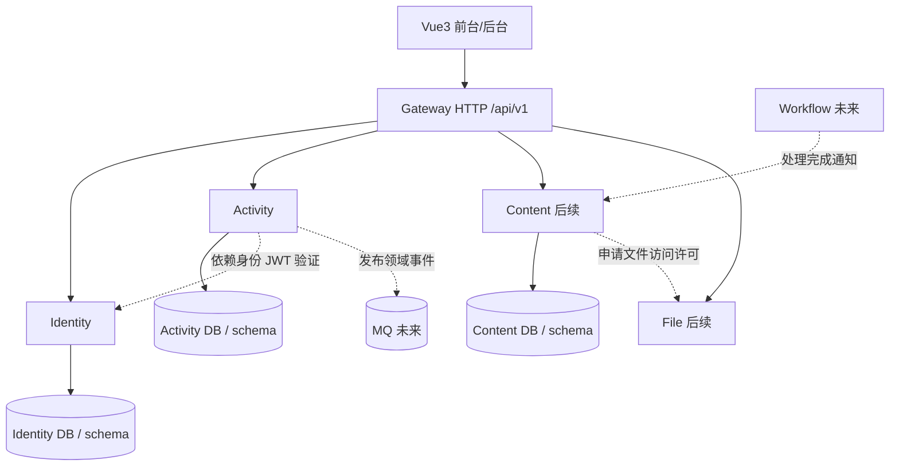

# 01 总体架构、服务边界与运行拓扑

## 1. 域划分（逻辑域不等于立刻创建所有运行实例）

| 领域 | 数据所有权 | MVP | 完整版扩展 |
|---|---|---|---|
| Identity | account、session、role、permission、组织成员（未来） | 认证与角色分配 | 租户成员、组织、角色自定义 |
| Activity | conference、venue、speaker、event、registration、credential、checkin | 大会、报名、核验、基础报表 | 场次订阅、工作坊等 |
| Content | article、exhibitor、achievement、material、media metadata | 少量只读样例可延后 | 投稿、展商自助、审核 |
| File | file_object、存储访问 | 文件接口将来接入 | 多租户文件隔离、短期签名 URL |
| Interaction | like、comment、signature、subscription 等 | 不做 | 互动功能 |
| Limited Seat / Payment | 批次、占席、订单、退款 | 不做 | 不混入普通报名事务 |
| Workflow | approval instance/task/history | 不做 | 流程引擎适配与回调 |
| Analytics | 跨域汇总只读视图/报表 | 活动域做基础统计 | 后期独立分析服务 |

**规则：服务拥有自己表的写入责任。** 同库部署不授权跨服务写表。跨域数据通过内部 API、事件或读模型取得；不允许 Admin 应用直接引入 Activity Mapper。

## 2. 逻辑依赖图

当前骨架仅包含 Gateway + Identity + Activity。Gateway 只是 HTTP 入口；不做跨领域业务写入。旧代码使用 Dubbo RPC，新方案不会假装无成本替换：未来若跨服务业务读需求产生，可建立接口端口+Dubbo 适配器，保持各域对基础设施实现解耦。

## 3. 请求链路

1. 客户端通过 Gateway 转发 `/api/v1/**`；追踪号在网关生成/透传。
2. Identity 登录签发 JWT，Activity 本地验证签名和 issuer；未来建议 RS256 公钥验签/JWKS。
3. 服务内部先功能权限，再范围策略，再对象归属，再业务状态。需要多租户时租户过滤始终在所有授权范围外层。
4. Controller 只绑定/校验 DTO；Application Service 编排事务；Domain Service 管理规则；Repository/Mapper 持久化；外部服务通过 Port/Adapter 访问。
5. 错误响应固定 `{code,message,details?,traceId,timestamp}`；成功 `{code,message,data,traceId,timestamp}`。分页 `{items,pageInfo}`。

## 4. 事务与一致性

- 同一 Activity 数据库的报名名额扣减、报名插入、凭证发行在一个本地事务完成；容量扣减必须原子条件 UPDATE，不允许 SELECT COUNT 后 INSERT；唯一键保护重复报名。
- 核验使用状态条件 UPDATE + 唯一索引确保一份凭证仅成功核验一次。
- 跨域调用不使用跨服务数据库事务；按需要使用 Outbox + 可靠消息、Inbox 去重、事件版本与幂等。
- 查询统计需明确来源；跨域报表初期在各域聚合，复杂实时分析按事件建立可重算读模型。
- 文件业务所有权属于内容/活动域，File 只维护对象及访问；下载签名必须经过所属业务域授权。

## 5. 多租户选择边界

- **独立部署模式**：同镜像按客户部署多套实例和数据库，可以没有应用层 tenant_id。
- **共享应用共享表模式**：业务表 tenant_id、签名验证后的可信 TenantContext、SQL fail-closed 租户过滤、缓存/文件/MQ 隔离、双租户集成测试缺一不可。
- 骨架保留 TenantContext 契约和字段，但不作为已验证共享多租户能力；首次真实启用必须执行 `docs/05-验收与缺口.md` 租户测试矩阵。

## 6. 可观测性与安全

- 访问日志结构化：traceId、service、operation、耗时、HTTP 状态；禁记录密码、令牌、凭证二维码原文和完整手机号。
- 健康检查区分 liveness/readiness；对 MySQL、Redis、MQ 等下游设超时与限流。
- JVM 异常、SQL 异常只记录内部日志，不返回堆栈。
- 管理 API 无论是否经过 Gateway，后端自身必须鉴权。
